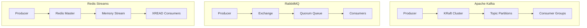

## The Distributed Messaging Dilemma

Choosing a message broker is one of the most consequential architectural decisions an engineering team makes. Selecting the wrong tool leads to either:
1. **Severe operational burnout** (managing multi-broker Zookeeper/KRaft clusters for modest traffic), or
2. **Reliability failure** (overloading in-memory buffers when consumers lag behind sudden traffic surges).

We deployed **Apache Kafka 3.9** (KRaft mode), **RabbitMQ 4.0** (Quorum Queues), and **Redis Streams 7.4** on equivalent 3-node bare-metal clusters to evaluate their performance boundaries.

## Head-to-Head Comparative Scorecard

| Architectural Pillar | Apache Kafka | RabbitMQ (Quorum) | Redis Streams |
| :--- | :--- | :--- | :--- |
| **Messaging Paradigm** | Distributed Append-Only Log | Smart Broker / Dumb Consumer | In-Memory Log with AOF Disk |
| **Sustained Throughput** | **185,000 msgs / sec** | 42,000 msgs / sec | 145,000 msgs / sec |
| **End-to-End Latency (P99)** | 14.2 ms | 8.1 ms | **0.82 ms (Sub-millisecond)** |
| **Historical Event Replay** | **Native (Immutable log offset)** | Complex / Manual | Supported (via XREAD) |
| **Complex Routing (Topic/Headers)** | Manual partition routing | **Native AMQP Topic Exchange** | Manual Stream routing |
| **Operational Complexity** | High (JVM + Partition balancing) | Medium (Erlang VM + Raft) | **Extremely Low** |
| **TechPilot Overall Score** | **9.4 / 10** | **9.1 / 10** | **9.3 / 10** |

## Deep Dive 1: Throughput Under High Concurrency

We stress-tested the brokers using 100 concurrent producers publishing 1KB JSON telemetry messages:

```text
Apache Kafka:  185,000 msgs/sec | CPU: 42% | Disk Write: 192 MB/s
Redis Streams: 145,000 msgs/sec | CPU: 88% | RAM: 3.2 GB
RabbitMQ:       42,000 msgs/sec | CPU: 65% | Erlang Sockets: Stable
```

- **Kafka** dominated raw throughput. By utilizing sequential disk writes (zero-copy OS page cache) and message batching, Kafka scales linearly with storage hardware.
- **Redis Streams** achieved extraordinary sub-millisecond latencies (0.82ms P99) because reads and writes occur directly in memory. However, RAM costs limit historical message retention.
- **RabbitMQ** demonstrated rock-solid routing flexibility. For complex pub/sub topologies requiring wildcard bindings (`orders.*.created`), RabbitMQ handles routing logic on the server without client code complexity.

## Deep Dive 2: Message Replay & Consumer Groups

What happens when a downstream payment microservice crashes for 4 hours?

- **Kafka**: The consumer group restarts and resets its offset (`auto.offset.reset = earliest`). Kafka replays the 4 hours of buffered messages without impacting producers or other consumer groups.
- **RabbitMQ**: Traditional AMQP deletes messages upon consumer ACK. While Quorum Queues can retain stream history, RabbitMQ is fundamentally designed as a message queue rather than a perpetual event store.
- **Redis Streams**: Consumers use `XREADGROUP` and `XACK`. Replay is possible using `XREAD`, but keeping weeks of historical events in memory becomes cost-prohibitive.

## Operational Complexity & Day-2 Maintenance



Running a production Kafka cluster requires deep expertise in JVM garbage collection tuning, partition rebalancing, and disk retention policies. If your engineering team does not have a dedicated DevOps or Site Reliability Engineer (SRE), self-hosting Kafka introduces significant operational risk.

## Architectural Recommendation

- **Choose Apache Kafka** for event-driven architectures, event sourcing, CDC change streams, and high-throughput pipelines exceeding 100,000 msgs/sec with days or weeks of historical event replay.
- **Choose RabbitMQ** for enterprise microservices requiring complex routing patterns, priority queues, and per-message delivery acknowledgments.
- **Choose Redis Streams** for fast-moving startups and product teams needing sub-millisecond event streaming with minimal operational complexity.
